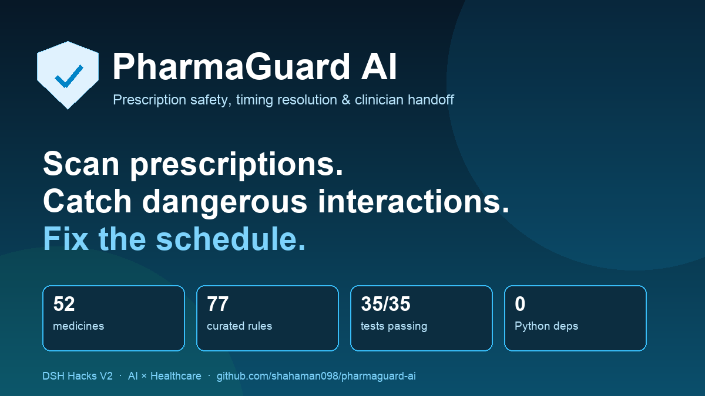

# PharmaGuard AI 🛡️💊

> **Scan a prescription label. Catch dangerous interactions. Get a safe 24-hour schedule and a pharmacist-ready handoff.**
>
> Built for **DSH Hacks V2 — AI × Healthcare**



[](tests/test_safety_engine.py)
[](#knowledge-base)
[](#quick-start)
[](LICENSE)

**Repo:** https://github.com/shahaman098/pharmaguard-ai · **Run locally:** `python3 server.py --port 8080`

[](https://render.com/deploy?repo=https://github.com/shahaman098/pharmaguard-ai)

---

## Why this exists

Adverse drug events are a leading preventable cause of emergency visits, and polypharmacy — five or more medicines across multiple prescribers — is routine for older adults. The dangerous gaps are usually not exotic: warfarin plus an NSAID, a statin plus a strong CYP3A4 inhibitor, calcium binding ciprofloxacin in the gut, or levothyroxine and iron taken together.

Most tools stop at a generic warning. PharmaGuard closes the loop:

1. **Read the regimen** from a label photo (browser OCR) or from the built-in registry.
2. **Screen it** against a deterministic pharmacology rule base.
3. **Resolve what can be resolved** with a constraint-based daily schedule.
4. **Hand off** a plain-language patient guide, a calendar export, and an SBAR draft for the pharmacist.

---

## What it does

| Stage | What happens |
|---|---|
| **Multimodal intake** | Upload a prescription-label photo. Tesseract.js (an LSTM-based OCR engine) runs locally in the browser, then the app proposes medicines and doses for human confirmation. No image is uploaded. |
| **Fail-safe audit** | 52-drug demo knowledge base and 77 curated rules covering CYP450, renal clearance, pharmacodynamic synergy, QT, bleeding, hyperkalemia, and GI chelation. **Unknown drugs are marked UNVERIFIED — never “safe.”** |
| **Constraint solver** | A deterministic backtracking scheduler enforces fasting windows, meal alignment, bedtime placement, twice-daily intervals, and 3–4 hour chelation spacing. Weekly and as-needed medicines are kept out of the daily timeline. |
| **Clinician handoff** | Generates an SBAR draft with the verified interactions, unverified medicines, timing issues, and explicit monitoring recommendations. |
| **Patient action** | Plain-language advice plus a one-click `.ics` export so every scheduled dose can be added to a phone calendar with alarms. |

---

## Architecture

```
Prescription label photo
        │
        ▼
Browser OCR (Tesseract.js) ──► detected drugs + doses
        │                         (human confirms)
        ▼
POST /api/audit
        │
        ▼
Deterministic safety engine (Python)
  ├── alias-aware drug resolution (brand + generic, token-safe)
  ├── pairwise interaction graph + therapeutic duplication checks
  ├── coverage / unverified-medication accounting
  └── transparent 0–100 risk index
        │
        ├──────────────► POST /api/reschedule
        │                  │
        │                  ▼
        │          Backtracking constraint solver
        │          (fasting, meals, intervals, spacing)
        │                  │
        │                  ├──► daily timeline
        │                  ├──► weekly / as-needed buckets
        │                  ├──► unresolved-conflict report
        │                  └──► .ics calendar export
        │
        └──────────────► POST /api/sbar
                           │
                           ▼
                   Pharmacist-review SBAR draft
```

The AI is deliberately split from the clinical decision layer:

- **Perception (AI/OCR):** reads noisy label text.
- **Safety (deterministic):** a rule engine makes the interaction calls, so the output is reproducible and auditable.
- **Optimization (deterministic):** the scheduler is a real search over interval constraints, not a hardcoded per-drug table.

---

## Knowledge base

- **52 medicines**, including generics, common US brands, and aliases.
- **77 rules**: pairwise interactions plus therapeutic-duplication checks.
- Curated from **FDA-approved prescribing information**, RxNorm-style naming, and standard pharmacology references.
- Coverage includes:
  - bleeding: warfarin + NSAIDs / aspirin
  - CYP450: simvastatin + clarithromycin/itraconazole, warfarin + amiodarone/metronidazole/fluconazole, clopidogrel + omeprazole
  - renal: lithium + NSAIDs/ACE inhibitors, methotrexate + NSAIDs
  - serotonergic: SSRIs + tramadol/linezolid
  - chelation: ciprofloxacin/levofloxacin + calcium/iron, levothyroxine + calcium/iron
  - cardiac: sildenafil + nitrates, metoprolol + verapamil, digoxin + amiodarone
  - metabolic: glipizide + insulin, metformin + iodinated contrast
  - hyperkalemia: ACE inhibitors/ARBs/spironolactone + potassium

> **This is a curated teaching subset, not a validated clinical database.** It is intentionally small enough to audit and demo. Real deployment would require a licensed interaction dataset, clinician review, and regulatory work.

---

## Quick start

Requires **Python 3.9+**. No pip packages.

```bash
git clone https://github.com/shahaman098/pharmaguard-ai.git
cd pharmaguard-ai

# 1. Run the test suite
python3 -m unittest discover tests -v

# 2. Start the app
python3 server.py --port 8080

# 3. Open http://localhost:8080
```

The label scanner loads Tesseract.js from a CDN. If OCR is unavailable, the scan dialog includes a paste-text fallback, and manual entry always works.

### Deploy

The server binds `0.0.0.0` and honors `$PORT`:

```bash
PORT=8080 python3 server.py
```

A `render.yaml` and `Procfile` are included for one-click Render/Railway-style deploys. The app has no database, no accounts, and no persistent storage.

---

## Demo cases

| Preset | What it demonstrates |
|---|---|
| **Cardiac polypharmacy** (6 medicines) | Two critical interactions + three timing/monitoring issues, a rescheduled timeline, and a critical-conflict-aware SBAR |
| **Serotonin risk** | SSRI + tramadol/linezolid serotonin-syndrome detection |
| **Thyroid + minerals** | Levothyroxine/calcium/iron chelation with 4-hour spacing |
| **Unverified medicine** | Fail-safe behavior: the app refuses to certify an unknown drug as safe |
| **No known interactions** | A clean regimen still gets the pharmacist-review disclaimer |

---

## Verification

```bash
python3 -m unittest discover tests -v
# Ran 35 tests — OK
```

The suite covers:

- brand/generic/alias resolution (including the regression that `"iron"` must **not** match `"spironolactone"`)
- 20+ high-yield interaction pairs
- unknown-drug fail-safe behavior and coverage accounting
- SBAR structure and unverified-medicine disclosure
- scheduler spacing (cipro/calcium ≥ 3h, levothyroxine/iron ≥ 4h)
- fasting, meal, bedtime, BID interval, weekly, and PRN behavior
- deterministic output, day-window bounds, and critical-pair separation

These are engineering tests, **not** a clinical validation study. See [`BENCHMARK-REPORT.md`](BENCHMARK-REPORT.md) for the honest scope and limitations.

---

## Repository layout

```
.
├── server.py                   # zero-dependency HTTP server + JSON API
├── pharmaguard/
│   ├── engine.py               # alias resolution, audit, SBAR, patient copy
│   ├── interactions.py         # 52-drug registry and 77 curated rules
│   └── scheduler.py            # backtracking constraint solver
├── static/
│   ├── index.html              # single-page clinical UI
│   ├── app.js                  # OCR intake, graph, timeline, .ics export
│   ├── style.css               # responsive clinical design system
│   └── samples/sample-label.png
├── tests/test_safety_engine.py # 35 tests
├── DEVPOST-COPY.md             # paste-ready submission story
├── DEMO-SCRIPT.md              # 2:30 walkthrough script
├── ONE-PAGE-SUMMARY.md/.html   # print-ready one-pager
├── BENCHMARK-REPORT.md         # verification scope and limitations
├── RESEARCH.md                 # research-oriented statement (YRI)
├── thumbnail.png               # Devpost thumbnail (1200x675)
└── SUBMISSION-KIT.md           # step-by-step submission checklist
```

---

## API

| Method | Path | Purpose |
|---|---|---|
| `GET` | `/api/health` | Liveness and KB version |
| `GET` | `/api/meta` | KB metadata, sources, disclaimer, feature flags |
| `GET` | `/api/drugs` | Registry with aliases and scheduling metadata |
| `POST` | `/api/audit` | `{ "medications": ["Warfarin", "Ibuprofen"] }` |
| `POST` | `/api/reschedule` | `{ "regimen": [...], "interactions": [...] }` |
| `POST` | `/api/sbar` | `{ "audit_result": {...}, "patient_name": "...", "age": 74 }` |

---

## Limitations & safety

- The knowledge base is a **curated demo subset**, not a licensed clinical database.
- OCR can misread labels; every detection requires human confirmation.
- The scheduler optimizes timing only. It does not calculate renal/hepatic doses, validate indications, or replace a pharmacist.
- The app has no accounts, no database, and stores no patient data. Patient name/age are used only to render the SBAR and calendar artifacts; they are not persisted.
- **Do not use this for real clinical decisions.**

---

## License

MIT License. See [`LICENSE`](LICENSE).
